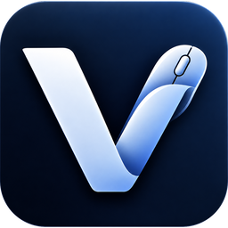
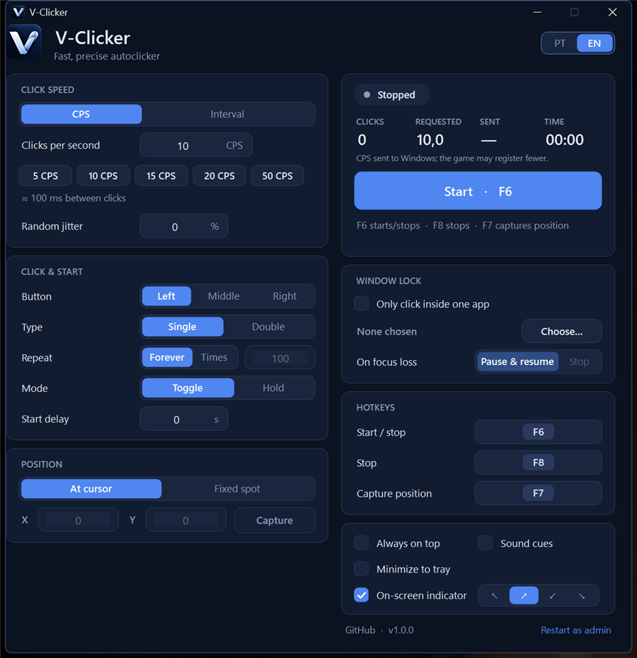

<div align="center">



# V-Clicker

**A fast, precise, lightweight autoclicker for Windows.**<br>
A single `.exe`: no installer, no telemetry, no network.

[](https://github.com/marquezinii/V-Clicker/actions/workflows/ci.yml)
[](LICENSE)


[🇧🇷 Português](README.md) · 🇺🇸 English



</div>

## Features

- **Real speed** – intervals from **1 ms** up to 24 h (up to ~1000 clicks/s, depending on the target program), using an absolute schedule that never accumulates lag plus a high-resolution wait.
- **Speed in CPS** (clicks per second, one decimal) or as an **interval in h / min / s / ms**: both edit the same speed, with no rounding (15 CPS = 66.667 ms). Presets `5`, `10`, `15`, `20` and `50 CPS`.
- **Window Lock**: pick an app (e.g. Roblox) and V-Clicker only clicks while it is in front. On Alt+Tab it **pauses and resumes by itself** when you come back (or stops, if you prefer). F6 only starts with the app in front; the *Start* button brings it to the front. It stops for good if the window closes, if a pause lasts over 5 minutes, or if the PC is locked or goes to sleep.
- **Random variation** (±0–50 %) for less mechanical clicking.
- **Left, middle or right button**, **single or double** click.
- **Repeat forever or N times** (up to 1 billion); it stops by itself when done.
- **Position**: at the cursor, or at a **fixed spot (X, Y)** that you capture with a button (3 s countdown) or a hotkey.
- **Toggle or Hold mode**: the hotkey switches on/off, or clicks **only while you hold it**.
- **Configurable global hotkeys** (default: `F6` start/stop, `F8` stop, `F7` capture position) that work while another program has focus or the window is minimized.
- **Start delay** (0–30 s) so you can position the mouse.
- **Live panel**: click count, **requested** CPS vs. CPS **sent to Windows** (the game may register fewer; V-Clicker does not pretend to measure that) and elapsed time.
- **On-screen indicator** (optional): a small pill in a screen corner shows *clicking*, *paused* or *stopped* over the game, never taking clicks or focus. The tray icon also changes color with the state.
- **System tray**, **always on top**, **sound cues**, **single instance**, **English/Portuguese** and a **dark theme** (dark title bar on Windows 10/11).
- **High-DPI aware** (4K screens, 125 % / 150 % scaling…).
- **Settings are saved automatically**, plus a **portable mode** (see below).
- Safety stop: if Windows refuses the click, V-Clicker stops and tells you instead of retrying forever.

## Download and use

1. Download the latest `V-Clicker.exe` from **[Releases](https://github.com/marquezinii/V-Clicker/releases)** (one file, nothing to install).
2. Double-click it. Set the interval, pick the button and the position.
3. Press **F6** (or the *Start* button) to begin and **F8** to stop.

Requirements: Windows 10 (1903 or newer) or Windows 11 — .NET Framework 4.8 ships with the OS, so there is nothing else to install.

| Default hotkey | Action |
| --- | --- |
| `F6` | Start / stop (or, in *Hold* mode, click while held down) |
| `F8` | Stop immediately, including during the start delay |
| `F7` | Capture the current cursor position as the fixed spot |

To change a hotkey, click its box and press the new combination (`Esc` cancels). `F1`–`F24`, navigation keys, the numeric keypad, or any key combined with `Ctrl`/`Alt` are accepted; bare letters are refused so they cannot break normal typing.

### FAQ

**Clicks do nothing in one particular program.** Programs running as administrator ignore input from normal programs (Windows privilege isolation). Use the **Restart as admin** link in the footer. Games with anti-cheat may also block simulated input — and many games and online services forbid autoclickers. Use it responsibly and follow each service's rules.

**My antivirus or SmartScreen complained.** Autoclickers simulate mouse input, which some antivirus products distrust, and the `.exe` is not code-signed. All source code is here and you can compile it yourself (see below). Every release lists the file's SHA-256.

**Where are the settings stored?** In `%APPDATA%\V-Clicker\settings.ini` (plain text, editable while the app is closed). For **portable mode**, create an empty `V-Clicker.ini` next to the `.exe` and it will use that file instead.

**F6/F7/F8 are already used by another program.** V-Clicker tells you in the window and you pick another key under *Hotkeys*.

**How accurate is the interval?** V-Clicker uses a high-resolution timer and busy-waits for the last couple of milliseconds, so the average rate matches the setting; each individual click still depends on Windows scheduling and on how quickly the target program handles input.

## Build

Requires the [.NET SDK](https://dotnet.microsoft.com/download) (any current version; the app itself targets .NET Framework 4.8).

```powershell
.\build.ps1                  # build -> src\bin\Release\net48\V-Clicker.exe
.\build.ps1 -Test            # build and run the unit tests
.\build.ps1 -Test -Package   # also writes dist\V-Clicker.exe, the .zip and SHA-256 files
.\build.ps1 -Integration     # + tests with real clicks and hotkeys (moves the cursor for a few seconds)
```

### Layout

```
src/             the app (WinForms, .NET Framework 4.8, no third-party dependencies)
  ClickEngine.cs   click loop on a dedicated thread (timing, jitter, hold mode, Window Lock pause)
  WindowLock.cs    Windows windows for Window Lock (list, focus, window area);  WindowPicker.cs  app chooser
  Hud.cs           on-screen indicator (separate window, click-through, never takes focus)
  Hotkey.cs        global hotkeys (RegisterHotKey) and validation
  Settings.cs      .ini settings with validation and a safe fallback
  MainForm.cs      main window;  Controls.cs / Theme.cs  dark controls and theme
  Loc.cs           Portuguese and English strings
tests/           dependency-free test runner (52 unit tests + 4 integration tests)
assets/          official icon
docs/            screenshots
```

The click engine talks to Windows through a tiny interface (`IClickSink`), so the timing, stop, blocked-input and hold-mode tests run without moving your mouse.

## License

[MIT](LICENSE) © 2026 marquezinii
