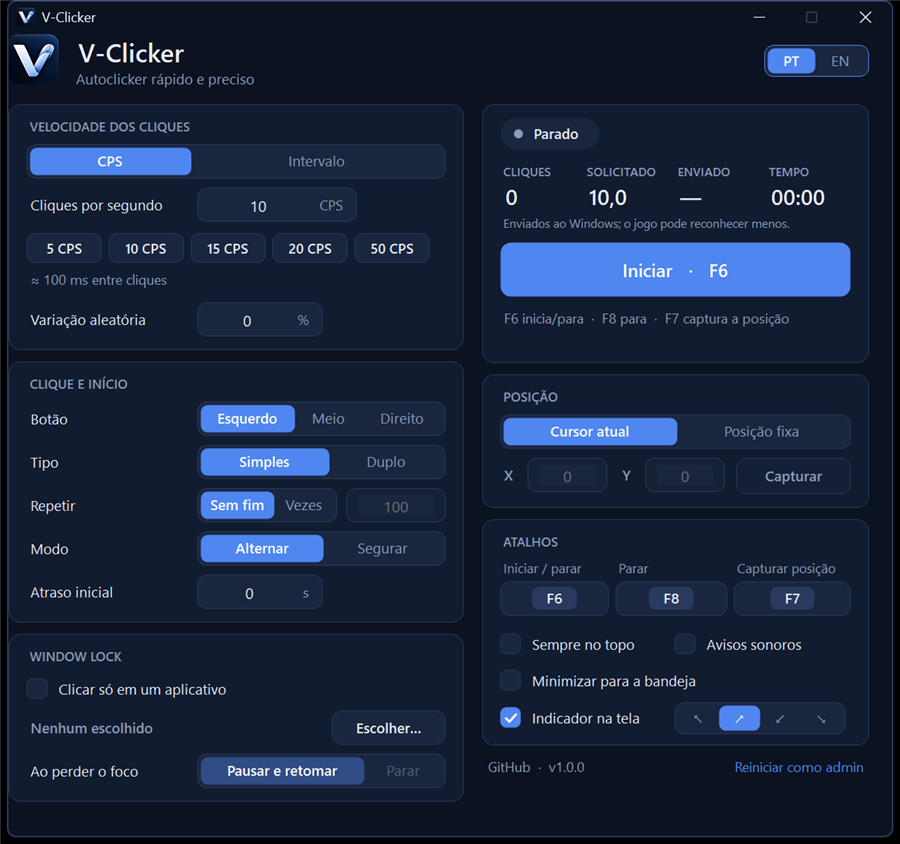

<div align="center">


# V-Clicker

**Autoclicker rápido, preciso e leve para Windows.**<br>
Um único `.exe`, sem instalador, sem telemetria, sem rede.

[](https://github.com/marquezinii/V-Clicker/actions/workflows/ci.yml)
[](LICENSE)


🇧🇷 Português · [🇺🇸 English](README.en.md)



</div>

## Recursos

- **Modo simples ou avançado**: o seletor no topo troca entre uma janela enxuta (velocidade, botão do mouse e atalhos, para quem só quer apertar F6) e a completa. Instalações novas começam no simples; o que foi configurado no avançado continua valendo, e o simples avisa numa linha ("Também valendo: Window Lock (Roblox) · posição fixa…").
- **Velocidade de verdade** – intervalo de **1 ms** até 24 h (até ~1000 cliques/s, dependendo do programa-alvo), com agenda absoluta que não acumula atraso e espera de alta resolução.
- **Velocidade em CPS** (cliques por segundo, com uma casa decimal) ou **intervalo em h / min / s / ms**: os dois editam a mesma velocidade, sem arredondar (15 CPS = 66,667 ms). Atalhos `5`, `10`, `15`, `20` e `50 CPS`.
- **Window Lock**: escolha um aplicativo (ex.: Roblox) e o V-Clicker só clica com ele em primeiro plano. Num Alt+Tab, **pausa e retoma sozinho** quando você volta (ou para, se preferir). F6 só começa com o aplicativo na frente; o botão *Iniciar* o traz para a frente. Para de vez se a janela fechar, se a pausa passar de 5 minutos ou se o PC for bloqueado ou suspenso.
- **Perfis por aplicativo**: com o Window Lock ligado, o V-Clicker lembra a configuração de clique de cada aplicativo (velocidade, botão, tipo, repetições, posição, atraso, modo e o que fazer no Alt+Tab) e a carrega quando você escolhe o aplicativo de novo, sem criar nem nomear nada. Atalhos e opções da janela valem para todos. Em *Perfis* (rodapé), exporte o perfil de um aplicativo, com as macros dele, num arquivo `.vcprofile` e importe em outro PC.
- **Macro Studio** (janela própria, botão no topo): clique em *Gravar*, escolha o aplicativo e faça a tarefa uma vez. Cada clique, tecla, texto e espera vira um passo em português (`Clicar (esquerdo) em 812, 440`, `Esperar 8 s`, `Digitar "Relatório"`), que você edita, salva e repete N vezes ou até parar. A macro só age na janela em que foi gravada (e nos diálogos dela): se outra janela vier para a frente, ela pausa; F8 para tudo na hora. Esperas longas podem ser encurtadas, sempre com a sua confirmação e com o tempo gravado guardado. Campos de senha não são gravados, e a execução para nesse ponto. Em navegadores, a troca de aba dentro da mesma janela não é detectada.
- **Esperar até… (Conditional Click)**, no Macro Studio: transforme uma espera gravada (ou insira do zero) em "esperar até o botão *Baixar PDF* estar disponível", "até a cor deste ponto aparecer" ou "até a janela *Salvar como* abrir". A macro segue assim que a condição é confirmada (duas leituras seguidas) e para antes do passo seguinte se o tempo máximo acabar. Tempo com outra janela na frente não conta; uma leitura duvidosa nunca libera a macro. Dá para voltar à espera original. Um elemento é esperado onde quer que esteja na janela; cor é observada num ponto fixo.
- **Alvo inteligente (Smart Target)**, no Macro Studio: um clique gravado passa a procurar *o que* clicar, em vez de *onde*. Aponte para o botão e aperte F7; o V-Clicker o reconhece **pelo nome** (acessibilidade do Windows, funciona no Chrome/Edge e na maioria dos programas) ou **pela aparência** (uma pequena região da tela, para jogos e programas sem nomes) e mostra uma prévia. Antes de cada clique, a macro procura o alvo e só clica se encontrar **exatamente um**, parado, habilitado e com ele mesmo sob o ponto do clique. Dois candidatos, alvo desativado, coberto ou não encontrado no tempo máximo (10 s por padrão): a macro para sem clicar e explica. O ponto gravado nunca é usado como plano B, mas dá para voltar para ele.
- **SafeClick (simulação e revisão)**, no Macro Studio: *Simular* captura a janela do aplicativo (sem trazê-la para a frente) e mostra, passo a passo, onde cada clique cairia, o texto que seria digitado e os atalhos, com o resultado de cada alvo e condição **na captura**. Nada é clicado, digitado ou enviado ao aplicativo; uma captura que não dá para confiar (jogos com aceleração gráfica costumam vir em branco) aparece como inconclusiva, nunca como confirmação. Antes da primeira execução de uma macro com ações potencialmente impactantes (Delete, Shift+Delete, Alt+F4, Ctrl+W, Ctrl+Shift+Esc), aparece uma revisão de segurança; aprovada, essa versão da macro não pergunta de novo (qualquer mudança, ou uma cópia importada, pede nova revisão). Cada macro também pode ter um **limite de duração** opcional, que encerra a execução mesmo durante pausas.
- **Variação aleatória** (±0–50 %) para cliques menos mecânicos.
- **Botão esquerdo, do meio ou direito**, clique **simples ou duplo**.
- **Repetir para sempre ou N vezes** (até 1 bilhão), parando sozinho ao terminar.
- **Posição**: no cursor ou em um **ponto fixo (X, Y)**, que você captura com um botão (contagem de 3 s) ou com um atalho.
- **Modo Alternar ou Segurar**: o atalho liga/desliga, ou clica **só enquanto você o segura**.
- **Atalhos globais configuráveis** (padrão: `F6` inicia/para, `F8` para, `F7` captura a posição), funcionando mesmo com outro programa em foco ou com a janela minimizada.
- **Atraso inicial** configurável (0–30 s) para você posicionar o mouse.
- **Painel ao vivo**: cliques, CPS **solicitado** vs. CPS **enviado ao Windows** (o jogo pode reconhecer menos; o V-Clicker não finge medir isso) e tempo.
- **Indicador na tela** (opcional): uma pequena pílula num canto da tela mostra *clicando*, *pausado* ou *parado* por cima do jogo, sem receber cliques nem foco. O ícone da bandeja também muda de cor com o estado.
- **Bandeja do sistema**, **sempre no topo**, **avisos sonoros**, **instância única**, **PT/EN** e **tema escuro** com título escuro no Windows 10/11.
- **Alto DPI** (telas 4K / escala de 125 %, 150 %…).
- **Configurações salvas** automaticamente e **modo portátil** (veja abaixo).
- Parada de segurança: se o Windows recusar o clique, o V-Clicker para e avisa em vez de insistir.

## Baixar e usar

1. Baixe o `V-Clicker.exe` mais recente em **[Releases](https://github.com/marquezinii/V-Clicker/releases)** (arquivo único, sem instalação).
2. Dê dois cliques. Ajuste o intervalo, escolha o botão e a posição.
3. Pressione **F6** (ou o botão *Iniciar*) para começar e **F8** para parar.

Requisitos: Windows 10 (1903 ou mais novo) ou Windows 11 — o .NET Framework 4.8 já vem com o sistema. Não precisa instalar nada.

| Atalho padrão | Ação |
| --- | --- |
| `F6` | Inicia / para (ou, no modo *Segurar*, clica enquanto estiver pressionado) |
| `F8` | Para imediatamente, inclusive durante o atraso inicial |
| `F7` | Captura a posição atual do cursor como ponto fixo |

Para trocar um atalho, clique na caixa dele e pressione a nova combinação (`Esc` cancela). Valem teclas `F1`–`F24`, teclas de navegação, teclado numérico, ou qualquer tecla combinada com `Ctrl`/`Alt`. Teclas soltas como letras são recusadas para não atrapalhar a digitação.

### Perguntas frequentes

**O clique não funciona em um programa específico.** Programas executados como administrador ignoram cliques de programas normais (isolamento de privilégios do Windows). Use o link **Reiniciar como admin** no rodapé do V-Clicker. Jogos com proteção anti-cheat também podem bloquear entrada simulada — e muitos jogos e serviços online proíbem autoclickers. Use com responsabilidade e respeite as regras de cada serviço.

**O antivírus ou o SmartScreen reclamou.** Autoclickers simulam entrada de mouse, o que alguns antivírus tratam com desconfiança, e o `.exe` não é assinado digitalmente. O código-fonte está todo aqui e você pode compilar você mesmo (veja abaixo). Cada release traz o hash SHA-256 do arquivo.

**Onde ficam as configurações?** Em `%APPDATA%\V-Clicker\settings.ini` (texto simples, editável com o programa fechado). Para o **modo portátil**, crie um arquivo `V-Clicker.ini` vazio ao lado do `.exe`: ele passa a usar esse arquivo.

**F6/F7/F8 já estão em uso por outro programa.** O V-Clicker avisa na janela e você escolhe outro atalho em *Atalhos*.

**Quão preciso é o intervalo?** O V-Clicker usa um cronômetro de alta resolução e, nos últimos milissegundos, espera ativamente; a média de cliques fica no valor configurado, mas cada clique individual ainda depende do escalonamento do Windows e de quão rápido o programa-alvo processa a entrada.

## Compilar

Requer o [.NET SDK](https://dotnet.microsoft.com/download) (qualquer versão atual; o app em si mira o .NET Framework 4.8).

```powershell
.\build.ps1                  # compila -> src\bin\Release\net48\V-Clicker.exe
.\build.ps1 -Test            # compila e roda os testes unitários
.\build.ps1 -Test -Package   # gera também dist\V-Clicker.exe, o .zip e os SHA-256
.\build.ps1 -Integration     # + testes com cliques e atalhos reais (move o cursor por alguns segundos)
```

### Estrutura

```
src/             o aplicativo (WinForms, .NET Framework 4.8, sem dependências de terceiros)
  ClickEngine.cs   laço de cliques em thread dedicada (cronometragem, jitter, modo segurar, pausa do Window Lock)
  WindowLock.cs    janelas do Windows para o Window Lock (lista, foco, área da janela);  WindowPicker.cs  escolha do app
  Hud.cs           indicador na tela (janela separada, transparente a cliques, nunca recebe foco)
  Macro*.cs        Macro Studio: formato .vcmacro, gravador (ganchos só durante a gravação), regras de passos,
                   janela vinculada, player com proteção a cada passo, condições "esperar até…" e a janela do Studio
  SmartTargets.cs  alvo inteligente: busca por UI Automation, captura de tela, conferência antes do clique, leitura do F7
  SafeClick.cs / MacroPreview.cs / SimulationDialog.cs  SafeClick: ações impactantes e aprovação, captura e
                   avaliação passiva dos passos, janela da simulação e revisão de segurança
  ImageTarget.cs   reconhecimento de imagem (correlação normalizada em blocos de 8 px; funções puras, testáveis)
  Profiles.cs / ProfilesDialog.cs  perfis por aplicativo do Window Lock: arquivo .vcprofile, exportar e importar
  Hotkey.cs        atalhos globais (RegisterHotKey) e validação
  Settings.cs      configurações em .ini, com validação e fallback seguro
  MainForm.cs      janela principal;  Controls.cs / Theme.cs / Icons.cs  teclas, LEDs, display e ícones desenhados (DESIGN.md)
  Loc.cs           textos em português e inglês
tests/           executor de testes sem dependências (135 testes unitários + 8 de integração)
assets/          ícone do app e identidade visual (assets/brand: ícone, logos e artes da marca)
docs/            capturas de tela
```

O mecanismo de cliques fala com o Windows por uma interface mínima (`IClickSink`), por isso os testes de cronometragem, parada, bloqueio e modo segurar rodam sem mover o mouse.

## Licença

[MIT](LICENSE) © 2026 marquezinii
